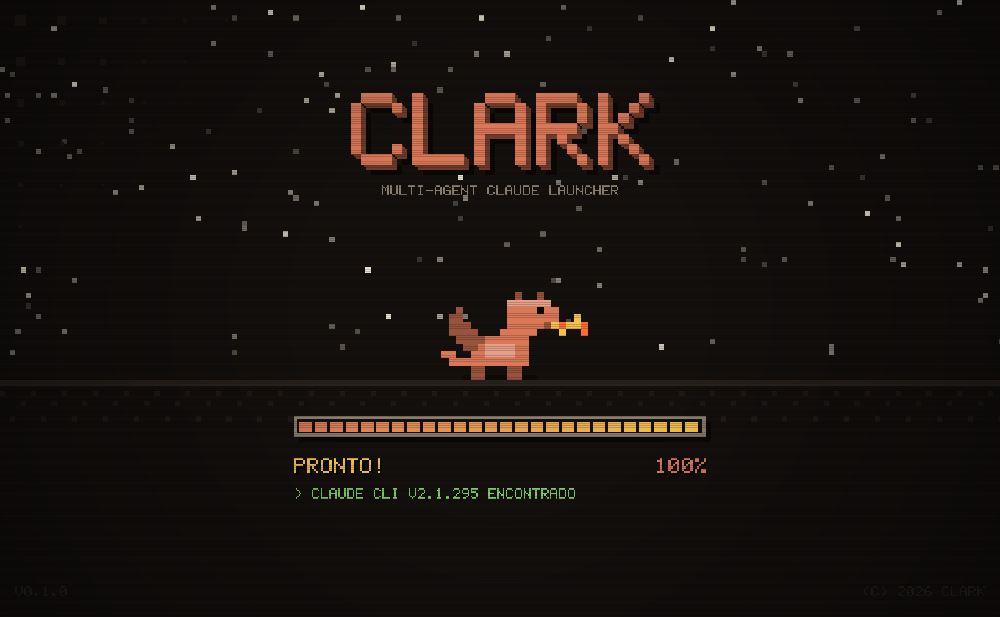
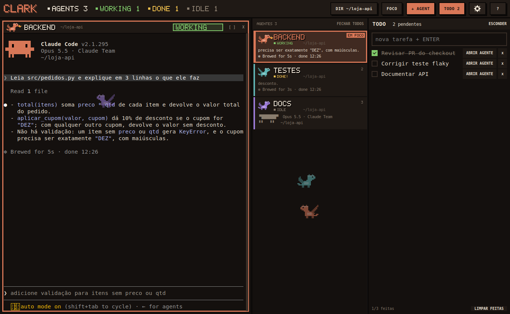
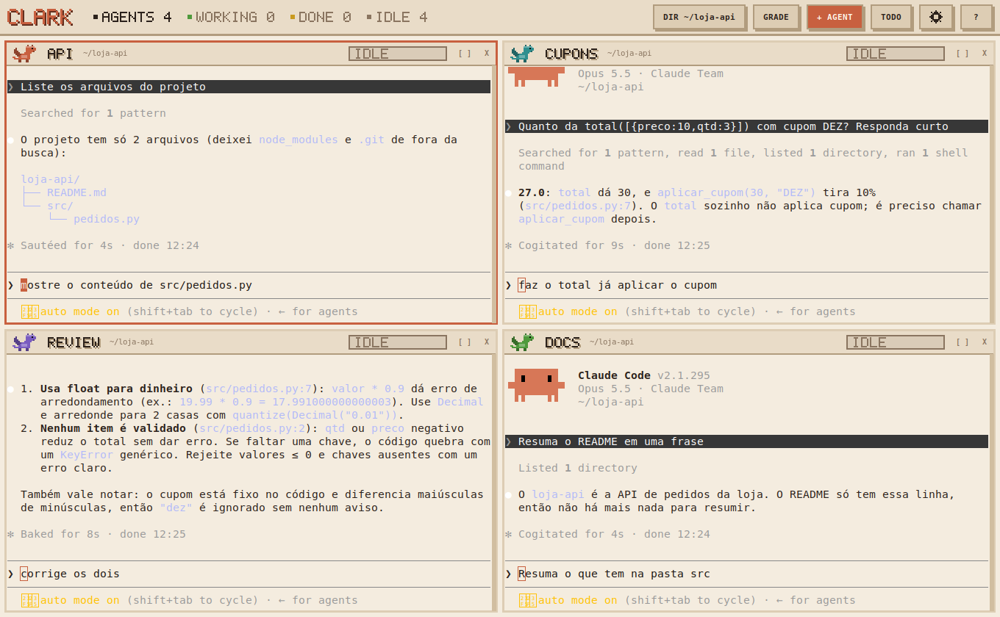

<p align="center"></p>

# CLARK

Launcher retrô em pixel art para rodar vários agentes [Claude Code](https://claude.com/claude-code) ao mesmo tempo, numa única janela.



**Modo foco:** um agente em destaque, a lista de agentes com o status de cada um (WORKING, DONE, IDLE) e a lista de tarefas ao lado.



**Modo grade:** todos os agentes lado a lado (aqui no tema claro).



## Requisitos

- Linux com GTK 3 (testado no Ubuntu 22.04)
- Python 3 com PyGObject, VTE e Cairo
- [Claude Code](https://docs.claude.com/en/docs/claude-code) instalado e logado (`claude` no PATH)

No Ubuntu/Debian:

```bash
sudo apt install python3-gi python3-gi-cairo gir1.2-gtk-3.0 gir1.2-vte-2.91
```

## Instalação

```bash
git clone https://github.com/GabrielBruno7/clark.git ~/clark
cd ~/clark
./install.sh
```

O instalador não usa sudo: confere as dependências e cria o comando `clark` em `~/.local/bin`, os ícones e o atalho no menu de aplicativos.
Não apague a pasta clonada depois de instalar: o comando `clark` aponta para ela.
Se o terminal disser `command not found: clark`, falta `~/.local/bin` no PATH (o instalador avisa). Adicione `export PATH="$HOME/.local/bin:$PATH"` ao `~/.zshrc` ou `~/.bashrc`.

## Uso

```bash
clark                 # abre o launcher
clark ~/projeto -n 3  # abre na pasta, já com 3 agentes
clark --no-splash     # pula a tela de abertura
clark --fresh         # começa sem restaurar a sessão anterior
clark -- <args>       # repassa argumentos para cada `claude`
```

## Atualizar

```bash
cd ~/clark && git pull
```

## Configuração

As preferências ficam em `~/.config/clark/config.json` e a maior parte é ajustada pela própria interface (tema, layout, tarefas).

**`auto_trust`** (padrão `false`): com `true`, o CLARK marca como confiável no `~/.claude.json` a pasta em que você abre um agente e aceita sozinho o diálogo "Do you trust the files in this folder?" do Claude Code. É prático, mas ignora uma proteção do Claude Code, então só ligue se você sempre abre agentes em pastas suas:

```json
{ "auto_trust": true }
```

## Desinstalar

```bash
~/clark/uninstall.sh
```

Remove o comando, o atalho e os ícones. A pasta do repositório e as configurações (`~/.config/clark`) continuam lá.

## Licença

[MIT](LICENSE)
